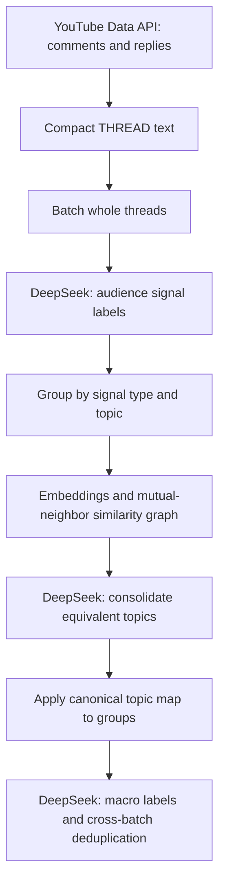

# YouTube comment analyzer

Turns a video's comment threads into audience signals so creators can see how viewers feel, what videos they want next, and what they find confusing. It produces JSON labels and topic groups, with references back to the discussion.

The labels capture:

- Praise, criticism, requests, and other responses as `affirmation`, `critique`, `suggestion`, `idea`, `question`, `confusion`, `disagreement`, or `meta`. Video requests can appear as suggestions or ideas, and doubts as questions or confusion.
- Emotion as `enjoyment`, `frustration`, `excitement`, `disappointment`, `curiosity`, `anger`, `trust`, or `neutral`, plus intensity.
- Specific topics, how clearly viewers express their point, reply engagement, and whether replies agree or dispute it.
- Broader macro topics that collect related topics across the video.

In our runs it cost about **₹50–100 for a video with 10,000 comments**. Labeling uses DeepSeek's `deepseek-chat` (at the time $0.28 per million input tokens and $0.42 per million output tokens), and `label_comments.py` logs token usage per run.

## How it works



The scripts call DeepSeek's `deepseek-chat` model. Labeling works on whole threads, so replies provide context for a signal. One comment can contain several signals, and several comments can support the same signal.

The difficult parts are preserving that context within token budgets and deciding which topic phrases mean the same thing. `label_comments.py` targets about 7,000 input tokens per batch and also limits thread count using an estimate of 150 output tokens per thread. These are estimates, not hard guarantees. Oversized threads are kept whole.

Topic consolidation embeds phrases with `all-MiniLM-L6-v2`, searches with FAISS, and groups mutual nearest neighbors above a similarity threshold. DeepSeek then decides which phrases to merge or keep separate. The canonical map combines topic buckets while retaining thread references. Finally, `macro_labeller.py` groups canonical topics in batches of 200, then merges equivalent macro labels across batches.

## What the output looks like

No recorded labeled output is included in this checkout. This is the **schema example from [systemPrompt.xml](systemPrompt.xml)**, not a result from a video:

```json
{
    "signals": [
        {
            "signal_type": "affirmation",
            "topics": ["heroic fantasy", "moral clarity"],
            "emotion": "enjoyment",
            "emotion_intensity": "medium",
            "intent_clarity": "clear",
            "specificity": "somewhat_specific",
            "local_prevalence_hint": "few_comments",
            "engagement_depth": "multi_reply_discussion",
            "consensus_state": "agreed",
            "affirmation_flag": true,
            "signal_strength_hint": "high",
            "source_comments": [1, 2],
            "thread_ref": "T1"
        }
    ]
}
```

The saved labeling file wraps signals in `threads`, adds the original `thread_id`, and keeps `source_comments` as local comment IDs. Grouped output contains signal counts, distinct thread counts, and thread IDs for each signal type and topic. Macro output contains `canonical_to_macro`, `macro_to_canonicals`, and `global_macro_list`.

Counts refer to signals and threads, not unique viewers. A signal can have multiple topics, so topic counts can overlap.

## Where to look

| File | Role in the pipeline |
| --- | --- |
| [youtube_comments_extractor.py](youtube_comments_extractor.py) | Paginate comments and replies, rotate keys, and write JSON or THREAD text. |
| [systemPrompt.xml](systemPrompt.xml) | Exact signal types, emotion labels, and source-reference schema. |
| [label_comments.py](label_comments.py) | Batch threads, call DeepSeek, map labels to threads, save progress, and log tokens. |
| [group_signals.py](group_signals.py) | Count signals and threads by signal type and topic. |
| [consolidate_topics.py](consolidate_topics.py) | Embed topics, build similarity groups, and request canonical labels. |
| [apply_canonical_map.py](apply_canonical_map.py) | Merge topic buckets using the canonical map. |
| [macro_labeller.py](macro_labeller.py) | Build broader topic labels and validate topic-number coverage. [macroPrompt.md](macroPrompt.md) records the design brief. |
| [DOCS_LABELING_PIPELINE.md](DOCS_LABELING_PIPELINE.md) | More detail on labeling, trace logs, and CLI options. Some descriptions predate the current code. |

The `experiment_*.py` scripts investigate pipeline choices:

- `experiment_consistency.py` repeats labeling and compares signal type, topic, and emotion sets using Jaccard similarity and exact matches.
- `experiment_merge_split.py` varies similarity thresholds and records how often DeepSeek merges or splits candidate groups.
- `experiment_transitive_closure.py` compares direct mutual-neighbor groups with groups connected through intermediate topics. `experiment_tc_merge_split.py` compares their merge/split behavior with DeepSeek.

These scripts measure repeatability and grouping behavior, not accuracy against human labels. Their generated reports are not included. `count_signal_types.py`, `extract_unique_topics.py`, and `analyze_final_topic_count.py` are inspection helpers. The Cursor chat and workspace scripts are separate from the analyzer.

## How this grew

This grew out of the [song recommendation engine](https://github.com/bigtopro/song-recommendation-engine) through an earlier private comment-analysis version. That version, developed from December 2025 to February 2026, combined clustering and GoEmotions emotion classification with a Django API and React dashboard.

This repo's [commit history](https://github.com/bigtopro/youtubeComments/commits) records the February 2026 progression from extraction to signal labeling, topic consolidation, and macro labels.

## Run the pipeline

The commands below document the scripts as written. They make API calls. The scripts call `deepseek-chat`; check DeepSeek's current model list before running them.

Install the dependencies:

```bash
python3 -m venv .venv
source .venv/bin/activate
pip install -r requirements.txt
```

Create a `.env` file in the repository root. `.gitignore` excludes it.

```dotenv
YOUTUBE_API_KEY_1=YOUR_YOUTUBE_API_KEY
DEEPSEEK_API_KEY=YOUR_DEEPSEEK_API_KEY
```

Run each stage in order, replacing `VIDEO_ID` with the video's ID:

```bash
python youtube_comments_extractor.py \
    --video-id VIDEO_ID --format threads --output threads.txt

python label_comments.py \
    --threads-file threads.txt --output labeled.json \
    --stats-file run_stats.json --llm-log-dir llm_outputs \
    --retry-empty-signals

python group_signals.py labeled.json --out buckets.json

python consolidate_topics.py buckets.json --out canonical_map.json

python apply_canonical_map.py buckets.json canonical_map.json \
    --out revised_buckets.json

python macro_labeller.py revised_buckets.json --from-buckets \
    --out macro_mapping.json --log-dir macro_logs
```

Use `--video-description` on the labeler and `--title` and `--description` on the macro labeller to supply video context. `extract_unique_topics.py` is an optional intermediate step; the macro labeller can read revised buckets directly.

The labeler saves results after each batch and supports `--resume` with a progress file. Inspect errors and empty signals before relying on the output. `--stats-file` covers the initial labeling pass's returned usage, not every paid retry or the consolidation and macro stages.

## Extractor details

The extractor paginates both top-level comments and replies through YouTube Data API v3. Replies are fetched concurrently with up to 32 workers. It can only retrieve comments the API makes available, and reply-fetch failures can leave incomplete output because worker exceptions are not currently checked.

### THREAD format

```text
THREAD <youtube_top_level_comment_id>
<local_id>|<parent_local_id>|<like_count>|<text>
```

Each thread starts at local ID `1`. Parent ID `0` marks the root. Parents precede children in depth-first order, siblings follow publication time, and blank lines separate threads. Text stays on one line. The labeler inserts a short `REF T1` header per thread in each API batch so the model can refer to it.

### Key rotation

Set one or more nonempty environment variables beginning with `YOUTUBE_API_KEY`, such as `YOUTUBE_API_KEY_1` and `YOUTUBE_API_KEY_2`. A thread-safe pool selects keys in round-robin order for requests. `--api-key` can add a key to the pool. Rotation distributes requests across configured keys; it does not retry a failed request with another key.

### Virtual deep threading

YouTube exposes replies under a top-level comment. The THREAD formatter infers a deeper tree from `@mentions`: it normalizes names and attaches each reply to the most recent earlier matching author in the thread. If no match exists, the reply stays under the root. This hierarchy is a heuristic, not a relationship supplied by YouTube.

For full comment objects instead of THREAD text, use `--format json`. The extractor also accepts `--page-size` from 1 to 100, `--indent` for JSON, and `--output` for a file. Without `--output`, it prints the result to standard output.
